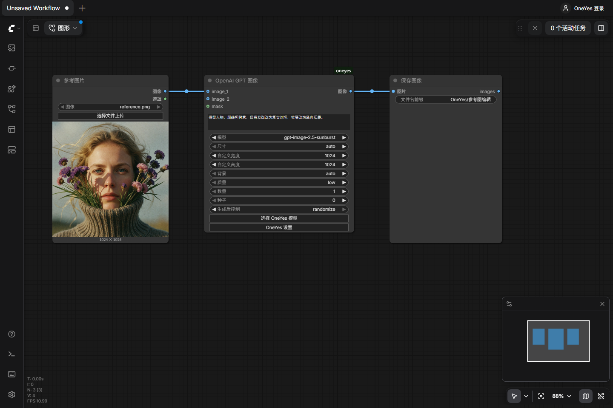
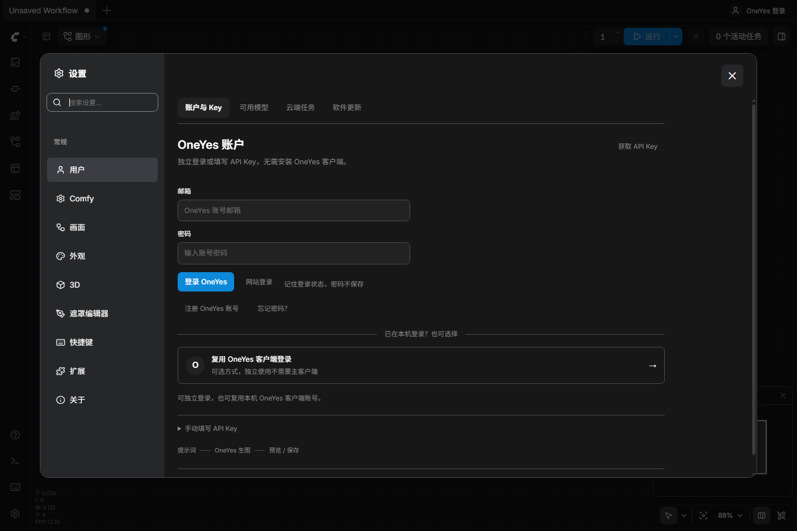
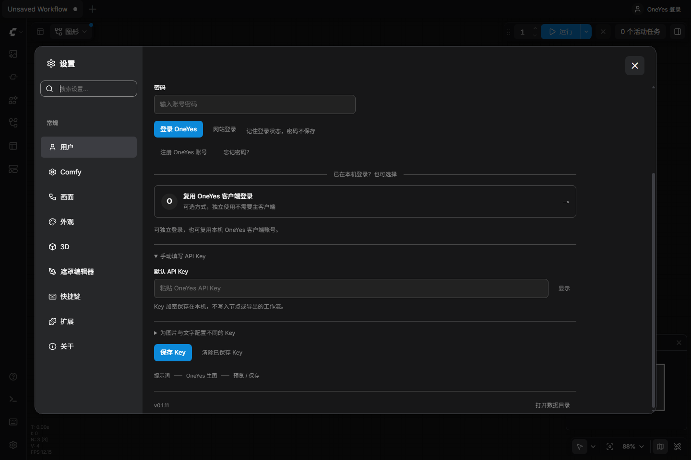
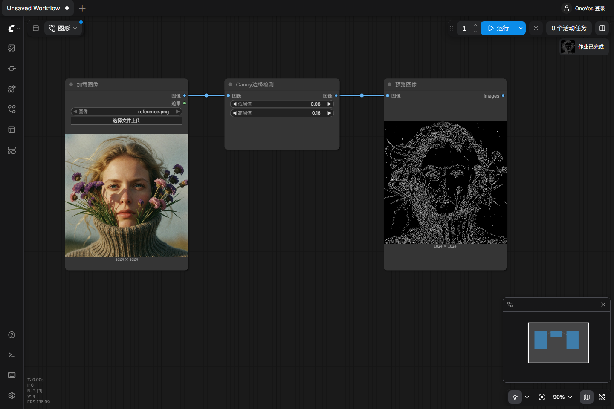

# OneYes ComfyUI 应用中心资料

OneYes ComfyUI 用节点连接图片、文字、云端生成和本地处理，适合制作可复用的参考图编辑、视觉创作和多步骤处理流程。它保留 ComfyUI 的画布、队列、参数、预览与工作流机制，使用 OneYes 账号或 API Key 接入已适配的云端模型，也可独立运行本地功能。

## 用途与入门

- **参考图编辑与视觉设计**：连接输入图片、提示词、GPT 图片等已适配模型以及保存节点，用于调整画面、制作插画、商品概念图和设计素材。遮罩、多图编辑等能力以所选模型为准。
- **文字辅助与视频生成**：使用已适配的 ChatGPT、Claude、Gemini 和 Grok 接口完成文字任务或视频生成，可用模型取决于 OneYes 的分组与权限。
- **本地节点处理**：使用原生图像处理、超分、音视频和 3D 相关节点，或加载本地模型。权重、扩展依赖和所需硬件需按节点准备，不是所有第三方服务均已接入。

安装后打开画布，点击右上角 **OneYes → 设置 → 用户** 登录或填写 Key，在模型页选择当前 Key 可用的模型，然后导入模板或连接节点运行。无需安装主客户端、Python 或基础运行依赖；复用 OneYes Desktop 的账号是可选方式。

异步图片任务的原回执保存在本机，断网或重启后可以在 **设置 → 用户 → 图片任务** 继续查询和取回，下载失败无需重新生成。账号与 Key 在本机加密，不写入导出工作流。软件内置签名 OTA，更新保留用户数据。

支持 Windows x64、macOS Apple Silicon、Linux x64／ARM64。云端生成需要网络、可用 Key 与余额，不依赖本地独立显卡；安装包内置 PyTorch CPU，不含模型权重。macOS 目前为自签名版本，未经过 Apple 公证。本应用为社区派生版本，并非 Comfy Org 官方发行版。

## 实际界面

截图版本、执行范围及素材授权见 [SCREENSHOTS.md](SCREENSHOTS.md)。

## 后续维护

面向应用中心的摘要、使用说明、详细介绍、截图与说明保存在 [listing.json](listing.json)。本次用户要求完善介绍；以后仅在用户明确要求改动相应资料时更新。

常规发版先读取管理平台现有 `oneyes-comfyui` 条目，调用 `scripts/catalog-entry.mjs` 的 `catalogRelease`，只同步版本、下载链接、包校验值及已有检测版本。保留管理平台维护的文案、截图、图标、排序、安装设置及修订版本，不能拿本目录基线覆盖后台后续编辑。明确修改资料时才使用 `catalogPresentation`，且不改安装包或图标。

截图链接固定到实际 Git 提交；新增截图必须保留来源记录，不能使用临时地址、个人账号信息或虚构生成结果。只修改本目录资料不递增客户端版本，不重新覆盖已签名的正式 OTA。
